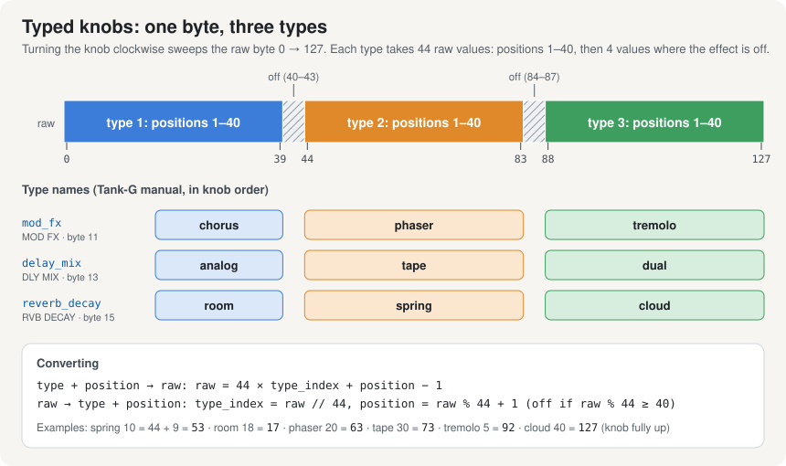

# Effect types: MOD FX, DLY MIX and RVB DECAY

Three knobs on the Tank-G do two jobs at once. Turning MOD FX, DLY MIX or RVB DECAY clockwise runs
through **three effect types**, one after the other, and within each type it sets **how much**.
Between two types there is a short zone where, according to the manual, the effect is off.

| Knob | Field | Preset byte | Types, in knob order | What the position sets (manual) |
|---|---|---|---|---|
| MOD FX | `mod_fx` | 11 | **chorus**, **phaser**, **tremolo** | chorus mix, phaser depth, tremolo mix |
| DLY MIX | `delay_mix` | 13 | **analog**, **tape**, **dual** | delay mix |
| RVB DECAY | `reverb_decay` | 15 | **room**, **spring**, **cloud** | reverb decay |

The other knob of each block (`mod_speed`, `delay_time`, `reverb_mix`) is a plain 0–127 knob.

## The sweep



Each knob is one byte, 0 at fully counter-clockwise, 127 fully clockwise. It splits the same way
for all three knobs: 44 raw values per type, numbered positions 1–40, then 4 values that belong to
no type.

| Raw | Section | MOD FX | DLY MIX | RVB DECAY |
|---|---|---|---|---|
| 0–39 | type 1, positions 1–40 | chorus | analog | room |
| 40–43 | off | — | — | — |
| 44–83 | type 2, positions 1–40 | phaser | tape | spring |
| 84–87 | off | — | — | — |
| 88–127 | type 3, positions 1–40 | tremolo | dual | cloud |

```text
type + position → raw:   raw = 44 × type_index + position − 1      (type_index 0, 1, 2)
raw → type + position:   type_index = raw // 44,  position = raw % 44 + 1,  off if raw % 44 ≥ 40
```

Examples: spring 10 = 53, room 18 = 17, phaser 20 = 63, tape 30 = 73, tremolo 5 = 92, cloud 40 =
127 (the knob's top; the third type has no off zone after it).

### Where this comes from, and how sure it is

- **The split** is `observed`: the owner set positions in the phone app and read the byte with
  `openvave preset dump` (2026-11-17, firmware 96). Every reading fit, for all three knobs,
  including both ends of each type and values in both off zones. The app draws each of these
  knobs as one arc in three colours (blue, orange, green), numbered 1–40 with `X` past 40; the app
  names no type.
- **The type names** come from the Tank-G manual (a third-party copy, not M-VAVE's own PDF), which
  describes each knob as three processes in this order with the effect off between them.
- **That the off zones silence the effect** is a `hypothesis`: stated by the manual, not yet heard.
- **Positions are not units.** Position 20 of spring is the middle of the spring section, not a
  number of seconds.

## Reading types

`preset dump` adds the reading after the raw value, and `watch` and `set` show both:

```text
      [11] mod fx                         0    0–127      confirmed  type: chorus 1
      [13] delay mix                      0    0–127      confirmed  type: analog 1
      [15] reverb decay                   5    0–127      confirmed  type: room 6
```

```text
 +9.51s  preset[15]  reverb decay      5 (room 6) → 64 (spring 21)
```

In an off zone the reading is `type: off`. JSON output (`--json`) carries only the raw value
(`"value": 5`); use `type_parts()` from the library to read it (see [Library guide](library.md)).

## Setting types

`set FIELD VALUE` takes a position 1–40 for these three fields, and three ways to say which type.

**Pick the type with `--type`:**

```text
$ openvave set reverb_decay 10 --type spring
Set reverb_decay 5 (room 6) → 53 (spring 10)   (current preset 1B, normal mode)
  write  00 59 22 16 00 00 04 04 00 00 10 0e 00 00 0f 04 3c 3c 46 32 32 00 00 00 00 35 04 07 64
  reply  00 59 00 01 00 00 00 ff   ACK
  after  [15] reverb_decay 53 (spring 10)   applied
Not saved. Discard: openvave preset reload   Keep: openvave preset save --unsafe
```

```bash
openvave set mod_fx 20 --type phaser      # raw 63
openvave set delay_mix 30 --type tape     # raw 73
```

**Keep the current type:** leave `--type` out. On a preset whose reverb is room,
`set reverb_decay 20` gives room 20. If the knob sits in an off zone there is no type to keep, and
the write is refused:

```text
$ openvave set reverb_decay 20
error: refused (type_required): reverb_decay sits between two types (the module is off there), so there is no current type to keep; pass a type (--type, or (type, position) in the library)
```

**Write the raw byte with `--raw`:** `openvave set reverb_decay 53 --raw` writes 53 (spring 10).
This is the only way to put a knob in an off zone (for example `--raw 41`).

**Several fields at once** use `FIELD=VALUE`, where a typed knob takes `POSITION` (keep the type),
`TYPE:POSITION` or `raw:N`:

```text
$ openvave set mod_fx=tremolo:5 reverb_decay=room:18 delay_mix=raw:44 --dry-run
Set 3 fields   (current preset 1B, normal mode)
  mod_fx        0 (chorus 1) → 92 (tremolo 5)
  reverb_decay  5 (room 6) → 17 (room 18)
  delay_mix     0 (analog 1) → 44 (tape 1)
  write  00 59 22 16 00 00 04 04 00 00 10 0e 00 00 0f 04 3c 3c 46 32 32 5c 00 2c 00 11 04 07 00   knob_block: mod_fx, reverb_decay, delay_mix
  dry run: nothing sent
```

Note that setting MOD FX or DLY MIX does not switch the block on: a preset with `mod_on` off stays
silent until you also send `mod_on=on` (moving MOD FX in the app did not turn the block on either).

Type names are case-insensitive. Positions outside 1–40 and unknown type names are usage errors
(exit 2).

In the library the value is a tuple: `("spring", 10)`, or `(None, 10)` to keep the current type.

## Amp types and IR cabs

`amp_type` (byte 5) and `ir_cab` (byte 17) are stepped selectors with **9 positions each**, 0–8.
They are not typed knobs (no sections, no off zones between types). Neither the pedal's protocol
nor the phone app names them, so openvave shows `#0`–`#8` (`off` for IR cab 0).

- `amp_type`: 9 amp models. The phone app shows the raw value plus one (1–9).
- `ir_cab`: **position 0 turns the cabinet simulation off**, positions 1–8 are 8 cabinet IRs. The
  manual says so ("the first slot means the IR has been turned off"), the phone app shows `OFF`
  for 0, and it sounded that way on the pedal (spec 007, 2026-11-19), so openvave prints `off` for
  0 and `#1`–`#8` otherwise (input stays the number: `set ir_cab 0`). The 8 cabinets can be
  replaced by importing IR files with the vendor software, so any names would only describe the
  factory IRs.

```bash
openvave set amp_type 3
openvave set ir_cab=0 amp_type=8
```

If you know which amp or cabinet a position models, a pull request to the protocol docs with your
evidence is welcome.
