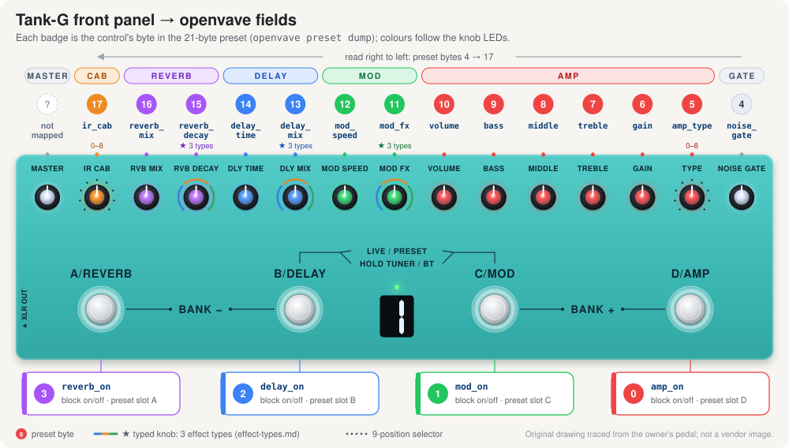
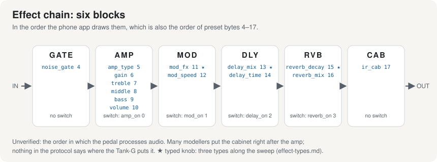
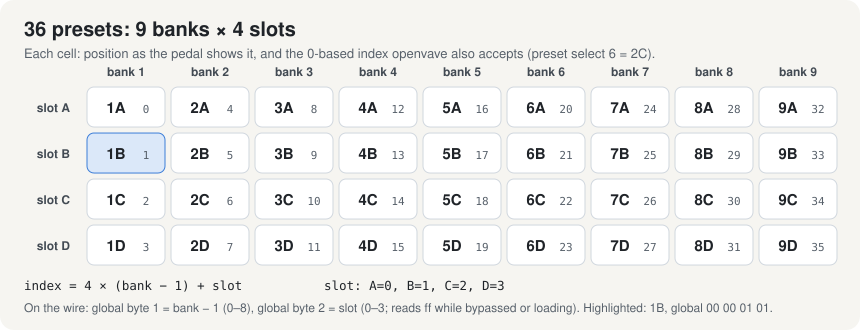

# The Tank-G explained

The Tank-G keeps the sound you hear in a 21-byte **preset**. Every knob, selector and block switch
on the pedal is one of those bytes, and openvave gives each one a field name. This page maps them
out.

All of it was worked out by moving one control at a time and watching which byte moved (`openvave
watch`), on firmware 96. The full byte map, with the evidence for every row, is in
[`command-layer.md`](../specs/protocol/command-layer.md#preset--global-byte-map-in-progress).

## The controls



The drawing groups controls by effect block in chain order; it is not a picture of the panel, and
the knobs on your pedal may be arranged and labelled differently.

| Control | Field | Preset byte | Values | Confidence |
|---|---|---|---|---|
| amp block on/off | `amp_on` | 0 | `on` / `off` | confirmed |
| mod block on/off | `mod_on` | 1 | `on` / `off` | confirmed |
| delay block on/off | `delay_on` | 2 | `on` / `off` | confirmed |
| reverb block on/off | `reverb_on` | 3 | `on` / `off` | confirmed |
| noise gate | `noise_gate` | 4 | 0–127 (the app shows 0 as `OFF`) | confirmed |
| amp type | `amp_type` | 5 | 9 positions, 0–8 | confirmed |
| gain | `gain` | 6 | 0–127 | confirmed |
| treble | `treble` | 7 | 0–127 | confirmed |
| middle | `middle` | 8 | 0–127 | confirmed |
| bass | `bass` | 9 | 0–127 | confirmed |
| volume | `volume` | 10 | 0–127 | confirmed |
| MOD FX | `mod_fx` | 11 | 0–127: chorus, phaser, tremolo ([types](effect-types.md)) | confirmed (types: observed) |
| mod speed | `mod_speed` | 12 | 0–127 | confirmed |
| DLY MIX | `delay_mix` | 13 | 0–127: analog, tape, dual ([types](effect-types.md)) | confirmed (types: observed) |
| delay time | `delay_time` | 14 | 0–127 | confirmed |
| RVB DECAY | `reverb_decay` | 15 | 0–127: room, spring, cloud ([types](effect-types.md)) | confirmed (types: observed) |
| reverb mix | `reverb_mix` | 16 | 0–127 | confirmed |
| IR cab | `ir_cab` | 17 | 9 positions, 0–8 | confirmed |
| preset LED colour | `led_colour` (write only) | 18–20 | R, G, B 0–255 each | observed |

Notes:

- **Values are raw.** 0–127 is the knob's full sweep (every knob reached both ends on the pedal).
  There are no units: openvave does not know what gain 60 means in dB or delay time 40 in ms.
- **Amp types and IR cabs have no names.** Each is a 9-position selector, 0–8 on the wire. The
  phone app shows them as numbers 1–9 and names neither. openvave prints `#0`–`#8` (the raw
  value). Neither the protocol docs nor the app give a list of amp models or cabinets, so these
  pages do not either.
- **Preset bytes 18–20** hold the colour of the preset LED, as red, green, blue. Writing
  `ff 00 00` turned the LED red in one session (observed), so `set led_colour` exists behind
  `--experimental`; `preset dump` still lists the three bytes as `unknown` until the byte map has a
  second session.
- Changing a knob on the pedal only takes effect in the pedal's edit mode (owner report). A remote
  change from openvave or the app works in normal mode.

## The effect chain



The phone app draws the sound as six blocks in this order, and the preset bytes follow the same
order:

1. **GATE**: noise gate (byte 4). No on/off switch; a gate of 0 is shown as off.
2. **AMP**: amp type, gain, three-band EQ (treble, middle, bass) and volume (bytes 5–10), switched
   by `amp_on`.
3. **MOD**: modulation; MOD FX picks chorus, phaser or tremolo and how much, plus speed (11–12),
   switched by `mod_on`.
4. **DLY**: delay; DLY MIX picks analog, tape or dual delay and how much, plus time (13–14),
   switched by `delay_on`.
5. **RVB**: reverb; RVB DECAY picks room, spring or cloud and how long, plus mix (15–16), switched
   by `reverb_on`.
6. **CAB**: cabinet impulse response, 9 positions (17). No on/off switch.

**Not verified:** the order in which the pedal actually processes audio. The list above is the
app's drawing order and the byte order. Many modelling pedals put the cabinet right after the amp,
before modulation, delay and reverb; nothing in the protocol says whether the Tank-G does.

## The 36 presets



The pedal stores **36 presets** in 9 banks of 4 slots, named `1A` to `9D`. openvave accepts either
the name or a 0-based index:

```text
index = 4 × (bank − 1) + slot        slot: A = 0, B = 1, C = 2, D = 3
1A = 0   1B = 1   2C = 6   9D = 35
```

There are two copies of a sound to keep apart:

- **Stored presets**: the 36 saved presets in the pedal's memory (a 758-byte image: a 2-byte
  header `a5 5a`, then 36 × 21 bytes). `preset backup` reads them; only `preset save` and
  `preset restore` change them.
- **The edit buffer**: the 21 bytes of the sound you hear right now. Selecting a preset copies its
  stored bytes into the buffer. `set` changes the buffer only, so a change is lost when you select
  another preset, `preset reload`, or power off, unless you save it.

The pedal does not tell the computer when you change something on it: openvave sees it the next
time it reads.

## Modes

Global byte 3 holds the pedal's mode. openvave reads it but never writes it (it cannot enter or
leave edit mode or the tuner; use the pedal for that).

| Value | Mode | openvave writes |
|---|---|---|
| 1 | **normal**: playing a preset | allowed (as the phone app does) |
| 0 | **edit**: the pedal's own edit mode | `set` allowed; `preset select` and `reload` need `--discard-edits`; `bypass on`, `save`, `restore` refused |
| 2 | **tuner** | every write refused |

The pedal's own edit mode is not needed for remote editing: `openvave set` and the phone app write
the edit buffer in normal mode, and the pedal stays in normal mode. Leaving the pedal's edit mode
without saving restores the stored preset (observed).

openvave also reports a **pedal state** (`state:` in `info`, `preset dump` and `watch`;
`pedal_state` in JSON): `normal`, `edit`, `tuner`, `bypass`, `loading` (the one poll while a
preset loads, when the slot briefly reads `ff`) or `unrecognised`.

## Bypass

**Bypass** turns the whole pedal off: clean sound, every LED off, as the app's BYPASS button does.
While bypassed the pedal reads slot `ff` and an all-zero buffer, so it does not say which preset
was loaded. That is why `openvave bypass on` prints the command to come back, and `bypass off`
needs a position:

```bash
openvave bypass on
openvave bypass off 1B
```

Leaving bypass selects that preset, which reloads its stored copy. Bypass changes nothing stored.
Both messages are `confirmed` on firmware 96. Details: [Recipes → Bypass](recipes.md#bypass).

## Loopback

The pedal's single status byte (`0xD0000000`) is a **loopback** flag. With it on (`01`, the value seen in
every early session), sound the pedal receives over Bluetooth audio, such as a backing track from a phone,
is mixed into its USB recording; with it off (`00`) you still hear that audio but it is not
recorded. The flag survives a power cycle. It was seen in one session (`observed`), so
`openvave loopback on|off` needs `--experimental`.

## What is not known yet

- The audio processing order (above).
- Names for the 9 amp types and 9 IR cabs.
- Device-info bytes (the `Device info` block of `info`), apart from the firmware version.
- Whether the "off" zones between effect types really silence the effect (the manual says so; not
  heard yet). See [Effect types](effect-types.md).
- Anything about MIDI or USB control: openvave speaks Bluetooth LE only.

Next: [Effect types](effect-types.md).
